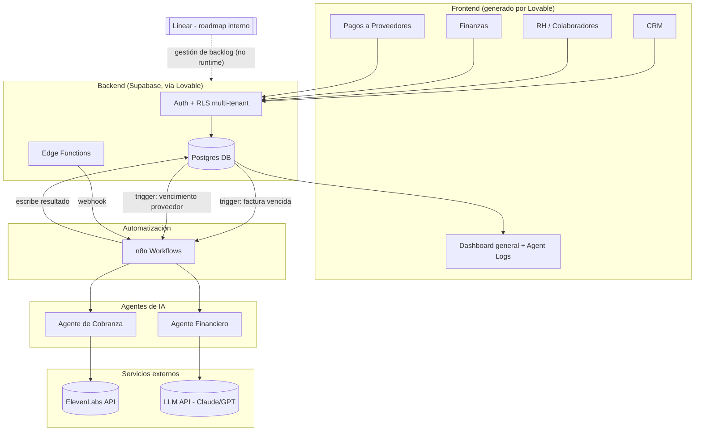

# Ándale — Plataforma de Gestión End-to-End para PyMEs de LatAm

**Hackathon:** TWM · **Duración:** 48h · **Equipo:** 2-3 personas · **Estructura:** Monorepo (desde cero)

---

## 0. Resumen ejecutivo

**Ándale** es una plataforma que ayuda a pequeñas y medianas empresas (PyMEs) de LatAm —empezando por México— a gestionar su operación completa (clientes, colaboradores, finanzas y proveedores) en un solo lugar, usando agentes de IA para automatizar tareas que hoy requieren contratar personal administrativo dedicado.

**Tesis:** muchas PyMEs mexicanas no tienen la infraestructura ni el presupuesto para pagar mano de obra especializada (un contador, un encargado de RH, un gestor de cobranza). Ándale reemplaza esa mano de obra con software + agentes de IA, a una fracción del costo.

Para el hackathon, los **4 módulos estarán completos y funcionales** en la demo:
1. **CRM** — cartera de clientes
2. **RH** — colaboradores (tipo Buk)
3. **Finanzas** — ingresos y egresos
4. **Pagos a proveedores** — tipo Dollar App (simulado, sin mover dinero real)

Stack: **Lovable** (full-stack, frontend + Supabase), **n8n** (automatización), **ElevenLabs** (agente de voz), **Linear** (roadmap post-hackathon).

---

## 1. Problema y oportunidad

- Las PyMEs en México (típicamente 5-50 colaboradores) operan con herramientas sueltas (Excel, WhatsApp, apps dispersas) o sin ninguna herramienta digital para administración.
- Contratar un equipo administrativo completo (RH, contabilidad, cobranza) es costoso y, para muchas PyMEs, no es viable.
- Herramientas existentes (Buk, QuickBooks, Dollar App, etc.) resuelven partes del problema por separado, con costos acumulados y sin automatización inteligente entre ellas.
- **Oportunidad:** una plataforma unificada + agentes de IA que hacen el trabajo que haría un administrativo (cobrar, alertar, conciliar) reduce la necesidad de mano de obra y el costo total de operar el negocio.

## 2. Visión de producto

> Que cualquier dueño de PyME en LatAm pueda administrar todo su negocio —clientes, gente, dinero y proveedores— desde un solo lugar, con agentes de IA que hacen el trabajo administrativo repetitivo por él.

## 3. Usuarios objetivo / personas

| Persona | Rol | Necesidad principal |
|---|---|---|
| **Dueño/Gerente general** | Multi-rol (ventas, RH, finanzas) | Ver todo el negocio en un vistazo, sin contratar más personal |
| **Encargado administrativo** (si existe) | Operación diaria | Herramienta simple que no requiera capacitación extensa |
| **Colaborador/empleado** | Usuario final de RH | Ver su información (recibos, vacaciones) sin pedirle al jefe |

**Segmento objetivo inicial:** PyMEs mexicanas de 5-50 colaboradores, en comercio, servicios profesionales y manufactura ligera, sin equipo de TI/administrativo dedicado.

## 4. Alcance del MVP (hackathon 48h)

### Dentro de alcance (in scope)
- CRM, RH, Finanzas y Pagos a proveedores — **CRUD + flujo principal funcional** en cada uno.
- 1 agente de IA funcional end-to-end (cobranza por voz con ElevenLabs), con un segundo agente como *stretch goal*.
- Al menos 2 workflows de automatización en n8n conectados a eventos reales de la plataforma.
- Multi-tenant básico (una empresa = un tenant, con su propio set de datos).

### Fuera de alcance (out of scope) para el hackathon
- Integración real con SAT/CFDI, IMSS o rieles bancarios reales (SPEI/STP) — todo se simula.
- OCR real de facturas (se puede mockear con un botón "simular lectura").
- Facturación multi-moneda / multi-país (se construye pensando en ello, pero no se implementa).
- Permisos y roles granulares más allá de "admin empresa" y "colaborador".

> ⚠️ **Nota de alcance:** construir 4 módulos completos + agente de IA + automatización en 48h con 2-3 personas es muy ambicioso. La recomendación es "full flujo, features mínimas": cada módulo debe tener su flujo principal impecable para la demo, no todas las features imaginables. Ver sección 11 (Riesgos).

---

## 5. PRD — Requisitos funcionales por módulo

### 5.1 CRM — Cartera de clientes
- Alta/edición/listado de clientes (razón social, RFC, contacto, dirección).
- Pipeline de oportunidades tipo kanban (Prospecto → Negociación → Ganado/Perdido).
- Historial de interacciones y notas por cliente.
- Estado de cuenta por cliente: facturas emitidas, pendientes y vencidas (se alimenta del módulo Finanzas).
- Dashboard de cartera: clientes activos, en riesgo (pago próximo a vencer) y morosos.
- Etiquetas/segmentación simple (ej. "cliente VIP", "riesgo alto").

### 5.2 RH — Colaboradores (tipo Buk)
- Alta/edición de colaboradores: datos personales, puesto, departamento, salario, fecha de ingreso.
- Organigrama simple por departamento.
- Gestión documental básica (subir contrato, identificación — almacenamiento mock).
- Control de vacaciones/ausencias (solicitar, aprobar, balance de días).
- Cálculo de nómina simplificado (sueldo bruto → neto, aproximación de IMSS/ISR, **no es cálculo fiscal real**).
- Portal de colaborador: cada empleado ve su propio recibo y balance de vacaciones (rol limitado).

### 5.3 Finanzas — Ingresos y egresos
- Registro de ingresos (ligado a ventas/CRM) y egresos (gastos operativos, nómina, pagos a proveedores).
- Categorización de transacciones (renta, nómina, proveedores, ventas, etc.).
- Dashboard de flujo de caja: entradas, salidas y saldo proyectado.
- Reporte simplificado tipo P&L por periodo (mes/trimestre).
- Alertas de saldo bajo o proyección de flujo negativo (input directo para el agente financiero).

### 5.4 Pagos a proveedores (tipo Dollar App, simulado)
- Alta/edición de proveedores (razón social, RFC, cuenta de contacto).
- Registro de facturas por pagar (manual; botón de "simular lectura OCR" como mock).
- Calendario/lista de vencimientos de pago.
- Simulación de pago: marcar como pagado, generar comprobante mock (PDF/registro), **no mueve dinero real**.
- Conciliación automática: al marcar pagado, se genera el egreso correspondiente en Finanzas.

### 5.5 Agentes de IA
| Agente | Función | Prioridad |
|---|---|---|
| **Agente de cobranza por voz** (ElevenLabs) | Detecta facturas de clientes vencidas (CRM + Finanzas) y genera una llamada/mensaje de voz recordando el pago | **Must-have** — es el agente ancla del demo |
| **Agente financiero** (LLM) | Analiza ingresos/egresos y genera un resumen/insight semanal de flujo de caja con alertas | Stretch goal |
| **Agente de atención interna** (LLM) | Chatbot dentro de la plataforma para dudas de uso (onboarding) | Stretch goal / post-hackathon |

Todas las interacciones de agentes se registran en una tabla `agent_logs`, visible en el dashboard, para que los jueces vean "la IA trabajando".

### 5.6 Automatizaciones (n8n)
1. **Factura de cliente vencida X días** → dispara el agente de cobranza (ElevenLabs) y registra el intento en `agent_logs`.
2. **Factura de proveedor próxima a vencer** → notificación (email/Slack/WhatsApp mock) al dueño.
3. *(Stretch)* **Alta de nuevo colaborador** → checklist de onboarding automático (enviar documentos, crear accesos).
4. *(Stretch)* **Nueva transacción financiera registrada** → recalcular dashboard de flujo de caja y disparar alerta si aplica.

---

## 6. TDR — Diseño técnico

### 6.1 Stack tecnológico

| Capa | Herramienta | Notas |
|---|---|---|
| Frontend + Backend | **Lovable** (full-stack) | Genera app React + backend/DB vía Supabase integrado |
| Base de datos | **Supabase (Postgres)** | Multi-tenant con Row Level Security (RLS) por `company_id` |
| Automatización | **n8n** | Cloud (recomendado) o Docker con túnel público para recibir webhooks |
| Agente de voz | **ElevenLabs API** | Conversational AI / TTS, orquestado desde n8n |
| Lógica de agentes LLM | API de Claude/GPT | Invocada desde n8n o Edge Functions de Supabase |
| Gestión de proyecto (post-hackathon) | **Linear** | Roadmap de features futuras, no usado en el producto en sí |
| Repo | Monorepo `hackathon-TWM` | `/docs`, `/n8n`, `/agents` (ver sección 9.1) |

### 6.2 Modelo de datos (entidades principales)

```
companies            (id, name, rfc, plan, created_at)        -- tenant raíz
users                (id, company_id, email, role)             -- admin | colaborador
clients              (id, company_id, name, rfc, contact, status, tags)
deals                (id, company_id, client_id, stage, amount, expected_close)
client_invoices      (id, company_id, client_id, amount, due_date, status) -- status: pendiente/pagada/vencida
interactions         (id, company_id, client_id, note, created_by, created_at)

employees            (id, company_id, name, department, position, salary, hire_date, status)
payroll_records      (id, company_id, employee_id, period, gross, net, created_at)
time_off_requests    (id, company_id, employee_id, days, status)

transactions         (id, company_id, type[income|expense], category, amount, date, related_table, related_id)

vendors              (id, company_id, name, rfc, contact)
vendor_invoices      (id, company_id, vendor_id, amount, due_date, status) -- status: pendiente/pagada/vencida
payments             (id, company_id, vendor_invoice_id, paid_at, mock_receipt_url)

agent_logs           (id, company_id, agent_type, target_table, target_id, action, result, created_at)
```

**Multi-tenancy:** toda tabla lleva `company_id`; políticas RLS en Supabase garantizan que cada empresa solo vea sus propios datos. Esto se configura en el **Hito 0**, no al final.

### 6.3 Integraciones

- **Lovable → Supabase:** generado automáticamente por Lovable (auth, CRUD, RLS vía su builder).
- **Supabase → n8n:** webhooks disparados por triggers de Postgres (o llamadas directas desde el frontend al workflow de n8n) cuando se crea/actualiza una fila relevante (ej. `client_invoices.status = 'vencida'`).
- **n8n → ElevenLabs:** nodo HTTP Request que llama a la API de ElevenLabs para generar/disparar la llamada o mensaje de voz.
- **n8n → Supabase:** al terminar, escribe el resultado en `agent_logs` vía API REST de Supabase.
- **Linear:** conectado solo a nivel de proceso de equipo (backlog de este documento), no es una integración de producto.

### 6.4 Seguridad y datos sensibles
- Datos de nómina y RH deben ser **ficticios** durante el hackathon (no usar datos reales de personas).
- RLS activo desde el día 1 para evitar fuga de datos entre tenants, incluso en demo.
- Pagos simulados: dejar explícito en la UI ("Pago simulado — no se mueve dinero real") para evitar confusión con jueces o usuarios piloto.

---

## 7. Arquitectura — Diagrama de backend



---

## 8. Modelo de negocio (Business Model Canvas simplificado)

| Bloque | Contenido |
|---|---|
| **Segmento de clientes** | PyMEs mexicanas, 5-50 colaboradores, sectores retail/servicios/manufactura ligera, sin equipo administrativo robusto |
| **Propuesta de valor** | Una sola plataforma (CRM + RH + Finanzas + Pagos) con agentes de IA que reemplazan tareas administrativas manuales, a una fracción del costo de contratar personal o pagar varias herramientas (Buk + QuickBooks + Dollar App, etc.) |
| **Canales** | Venta digital directa, alianzas con cámaras de comercio/incubadoras, referidos de contadores/consultores PyME |
| **Relación con clientes** | Self-service + onboarding asistido + soporte vía agente de IA interno |
| **Fuentes de ingreso** | Suscripción SaaS mensual por tiers + add-ons (minutos de agente de voz, usuarios/colaboradores extra) |
| **Recursos clave** | Plataforma (Lovable/Supabase), integraciones (n8n, ElevenLabs), equipo fundador |
| **Actividades clave** | Desarrollo de producto, integración/mejora de agentes de IA, soporte a PyMEs, compliance futuro (RH/nómina/CFDI) |
| **Socios clave** | Lovable, n8n, ElevenLabs; a futuro, integraciones con SAT/bancos; Linear para gestión interna |
| **Estructura de costos** | Hosting (Supabase/n8n), costo de APIs (LLM, minutos ElevenLabs), soporte, adquisición de clientes |

### Pricing propuesto (hipótesis para el pitch, a validar)

| Plan | Precio sugerido | Incluye |
|---|---|---|
| **Starter** | ~$49 USD/mes | Hasta 10 colaboradores, CRM + Finanzas completos, RH y Pagos limitados |
| **Growth** | ~$149 USD/mes | Todos los módulos completos, hasta 50 colaboradores, 1 agente de IA incluido (minutos limitados) |
| **Pro** | Precio a cotizar | Agentes de IA ilimitados, soporte dedicado, integraciones a medida |

> Estos números son un punto de partida para el pitch, no una decisión final — se deben validar con entrevistas a PyMEs reales post-hackathon.

---

## 9. Roadmap de hitos (sprint de 48h)

### 9.1 Estructura del repo (monorepo)

```
hackathon-TWM/
├── docs/           # este documento y otros (pitch deck, research)
├── app/            # export/referencia del proyecto Lovable (si aplica)
├── n8n/            # workflows exportados (JSON) de n8n
├── agents/         # prompts, scripts y configuración de agentes IA
└── README.md
```

### 9.2 Bloques de tiempo sugeridos

| Bloque | Horas | Foco |
|---|---|---|
| **Hito 0 — Fundación** | h0–h6 | Setup de Lovable, Supabase, modelo de datos, auth multi-tenant, repo, n8n, cuenta ElevenLabs |
| **Hito 1 — CRM** | h6–h14 | Flujo completo de clientes y pipeline |
| **Hito 2 — RH** | h14–h22 | Flujo completo de colaboradores |
| **Hito 3 — Finanzas** | h22–h30 | Ingresos/egresos y dashboard de flujo de caja |
| **Hito 4 — Pagos a proveedores** | h30–h36 | Proveedores, facturas, pago simulado, conciliación |
| **Hito 5 — Agentes + n8n** | h36–h42 | Agente de cobranza por voz + workflows de automatización |
| **Hito 6 — Integración y QA** | h42–h46 | Conectar todo, datos semilla, pruebas end-to-end, pulido UI |
| **Hito 7 — Pitch** | h46–h48 | Deck, modelo de negocio final, ensayo de demo |

---

## 10. Backlog de tickets (para importar a Linear)

### Épica 0 — Setup & Fundación
- [ ] T0.1 Crear proyecto en Lovable y conectar Supabase
- [ ] T0.2 Modelo de datos multi-tenant (`companies`, `users`, roles) + políticas RLS
- [ ] T0.3 Auth (signup/login, selección/creación de empresa)
- [ ] T0.4 Estructura del monorepo (`/docs`, `/app`, `/n8n`, `/agents`) + este PRD/TDR
- [ ] T0.5 Setup de n8n (cloud o Docker + túnel público) y conexión webhook a Supabase
- [ ] T0.6 Cuenta y voz base configurada en ElevenLabs
- [ ] T0.7 Crear equipo/proyecto en Linear con estas épicas para el roadmap post-hackathon

### Épica 1 — CRM
- [ ] T1.1 Modelo de datos: `clients`, `deals`, `interactions`, `client_invoices`
- [ ] T1.2 CRUD de clientes
- [ ] T1.3 Pipeline de oportunidades (kanban)
- [ ] T1.4 Historial de interacciones/notas por cliente
- [ ] T1.5 Dashboard de cartera (activos / en riesgo / morosos)
- [ ] T1.6 Vincular estado de cuenta del cliente con Finanzas

### Épica 2 — RH
- [ ] T2.1 Modelo de datos: `employees`, `payroll_records`, `time_off_requests`
- [ ] T2.2 CRUD de colaboradores
- [ ] T2.3 Organigrama simple por departamento
- [ ] T2.4 Carga de documentos (mock)
- [ ] T2.5 Control de vacaciones/ausencias
- [ ] T2.6 Cálculo simplificado de nómina (bruto/neto)
- [ ] T2.7 Portal de colaborador (rol limitado)

### Épica 3 — Finanzas
- [ ] T3.1 Modelo de datos: `transactions`, categorías
- [ ] T3.2 Registro de ingresos (ligado a CRM)
- [ ] T3.3 Registro de egresos (gastos, nómina, proveedores)
- [ ] T3.4 Dashboard de flujo de caja
- [ ] T3.5 Reporte P&L simplificado por periodo
- [ ] T3.6 Alertas de saldo bajo / proyección de flujo

### Épica 4 — Pagos a proveedores
- [ ] T4.1 Modelo de datos: `vendors`, `vendor_invoices`, `payments`
- [ ] T4.2 CRUD de proveedores
- [ ] T4.3 Registro de facturas por pagar (+ botón "simular OCR")
- [ ] T4.4 Calendario/lista de vencimientos
- [ ] T4.5 Simulación de pago + comprobante mock
- [ ] T4.6 Conciliación automática con Finanzas (genera egreso)

### Épica 5 — Agentes de IA + n8n
- [ ] T5.1 Workflow n8n: factura de cliente vencida → dispara agente de cobranza
- [ ] T5.2 Agente de cobranza por voz (script + llamada/mensaje vía ElevenLabs)
- [ ] T5.3 Workflow n8n: factura de proveedor próxima a vencer → notificación
- [ ] T5.4 *(Stretch)* Agente financiero: insight semanal de flujo de caja (LLM)
- [ ] T5.5 *(Stretch)* Workflow n8n: alta de colaborador → checklist de onboarding
- [ ] T5.6 Tabla y vista de `agent_logs` en el dashboard

### Épica 6 — Integración, QA y Demo
- [ ] T6.1 Navegación única / dashboard general conectando los 4 módulos
- [ ] T6.2 Datos semilla realistas (empresa mexicana ficticia)
- [ ] T6.3 Pruebas end-to-end del flujo principal de demo
- [ ] T6.4 Pulido de UI/UX (branding Ándale)
- [ ] T6.5 Grabar video de respaldo de la demo (por si falla internet en vivo)

### Épica 7 — Pitch & Negocio
- [ ] T7.1 Pitch deck (problema, solución, demo, modelo de negocio)
- [ ] T7.2 Definir pricing/tiers finales
- [ ] T7.3 Preparar respuestas a diferenciadores vs. Buk / QuickBooks / Dollar App

---

## 11. Riesgos y supuestos

- **Alcance vs. tiempo:** 4 módulos completos + agente de IA + automatización en 48h con 2-3 personas es muy ambicioso. Mitigación: cada módulo cubre su flujo principal, no todas las features; usar mocks donde no sea crítico para el demo (nómina real, OCR real).
- **ElevenLabs:** requiere cuenta y créditos; probar la latencia de la llamada/mensaje temprano (Hito 0-1), no dejarlo para el final.
- **n8n accesible públicamente:** si se corre local, se necesita un túnel (ngrok o similar) para recibir webhooks de Supabase; se recomienda n8n cloud para evitar este problema.
- **RLS multi-tenant:** debe configurarse desde el Hito 0; agregarlo al final es mucho más riesgoso y propenso a fugas de datos entre tenants.
- **Datos sensibles:** usar siempre datos ficticios para RH/nómina durante el hackathon.
- **Pagos simulados:** dejarlo explícito en la UI para no generar expectativas de movimiento real de dinero.

## 12. Próximos pasos post-hackathon

- Entrevistas de validación con PyMEs reales en México.
- Definir compliance real: CFDI/SAT para facturación, IMSS/ISR real para nómina.
- Evaluar integración real de pagos (SPEI/STP, Stripe, Conekta) y sus requisitos regulatorios.
- Formalizar **Linear** como herramienta de gestión de producto con roadmap trimestral.
- Expandir agentes de IA (más casos de uso, tono/voz de marca, idiomas para otros países de LatAm).
